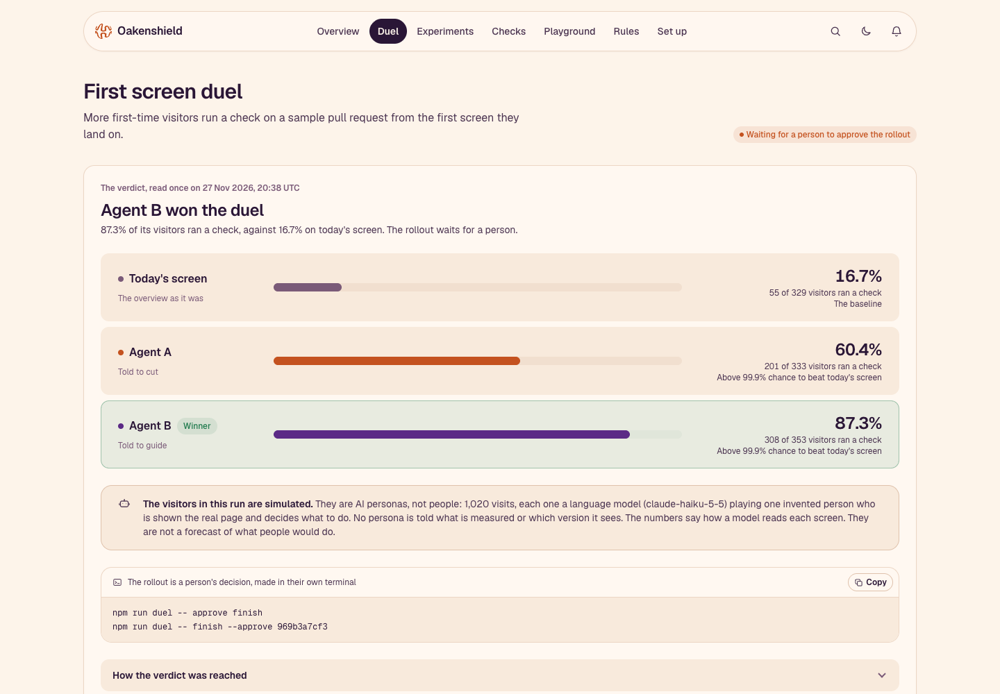
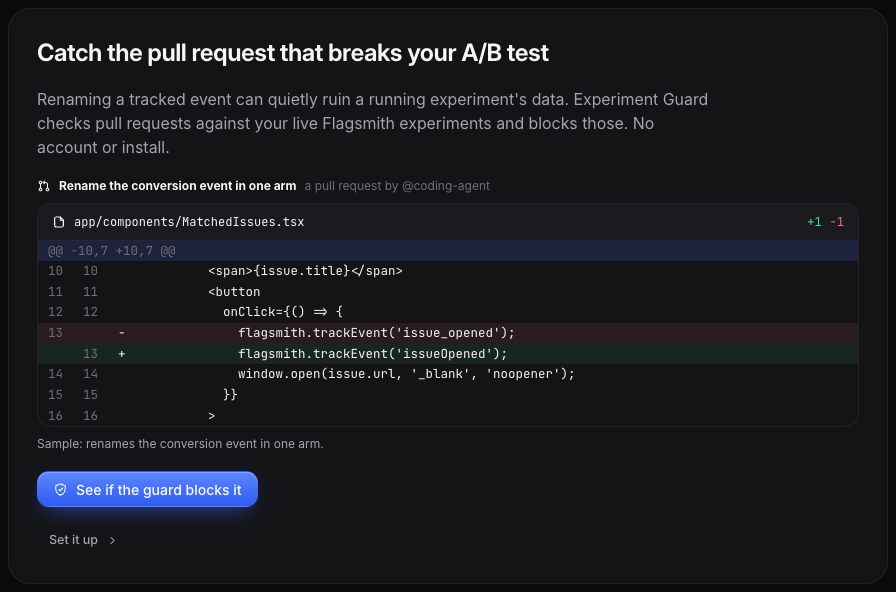
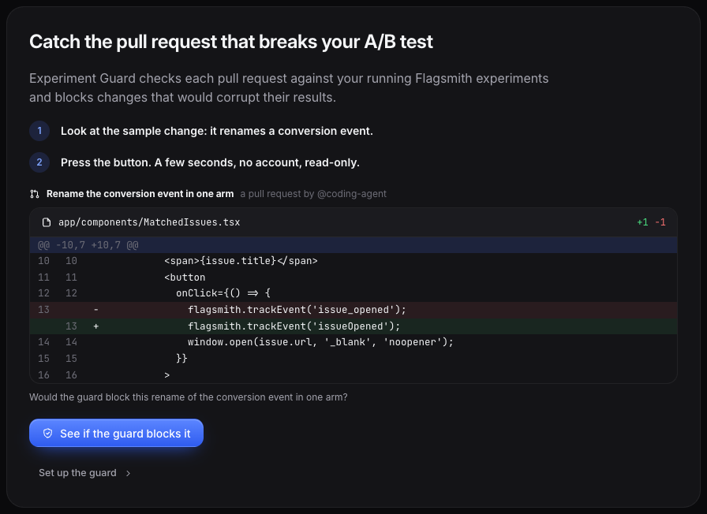
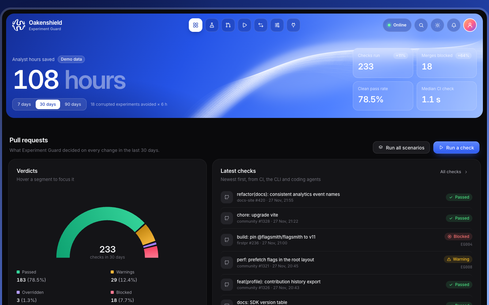
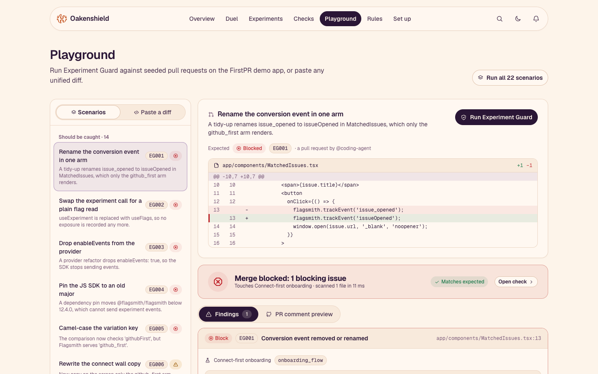
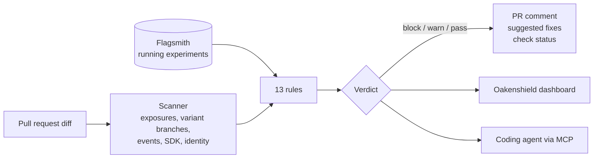

<p align="center"></p>

# Oakenshield

**Two AI agents disagree about a change. A Flagsmith experiment settles it. A person approves the start and the rollout, and a referee keeps the run honest in between.**

An agent can write three versions of a screen in a minute and argue well for every one of them. Arguing does not settle which is better. Oakenshield gives two agents the same brief and opposite convictions, lets each write its own version and attack the other's, and then stops the argument: both versions run against today's in one Flagsmith experiment, and what visitors do decides. The agents hold no Flagsmith credentials. Nothing starts and nothing ships without a person's yes.



| Part | Path | What it is |
|---|---|---|
| **The duel** | `packages/duel`, `duels/first-screen` | Two agents compete to improve the first screen of this project's own dashboard. One Flagsmith experiment with three versions picks the winner. |
| **The `flagsmith-duel` Agent Skill** | `skills/flagsmith-duel` | The same job for any coding agent and any flag, on the Flagsmith CLI: plan, start, seal, audit, verdict, rollout. One line of JSON per step. |
| **Experiment Guard** | `packages/guard`, `action.yml` | The referee for code. It blocks pull requests that would silently corrupt a running Flagsmith experiment, the duel's included. |

## How a duel runs

| | Step | Who | What happens |
|---|---|---|---|
| 1 | The brief | A person | Writes one goal, the one event that counts, and a fact sheet: everything a version is allowed to claim. |
| 2 | Two proposals | The agents | Same brief, opposite convictions. Each writes a version, a hypothesis in one sentence, and a predicted result for all three versions. |
| 3 | Cross examination | The agents | Each attacks the other's version, concedes what it does better, and may revise its own once. The transcript is kept. |
| 4 | Referee check | The referee | Rejects a version that drops, renames or doubles the measured event, or claims something the fact sheet does not support. A rejected version goes back to its agent once. |
| 5 | Start approved | **A person** | Nothing exists in Flagsmith until now. The person confirms on their own terminal and passes an approval code, which is a digest of the plan. |
| 6 | The experiment | Flagsmith | One flag, three versions: today's as control and one variation per agent, whose value is that agent's whole version. The run is sealed. A change to it in Flagsmith breaks the seal, and a change to its code is blocked in the pull request. |
| 7 | The verdict | The referee | Read once, when every version has its planned sample, by a rule fixed before the start. "Neither beats today's" is a valid answer. Each agent's prediction is scored. |
| 8 | Rollout approved | **A person** | A second yes. Flagsmith completes the experiment with the winner, the flag serves it to everyone in that environment, and the losing version is removed. |

Steps 5 to 8 are the `flagsmith-duel` skill's script, which does every Flagsmith read and write through the Flagsmith CLI. The duel engine and an agent that uses the skill run exactly the same code.

## The first duel: this dashboard's first screen

Everything in this section is on disk in `duels/first-screen/`: the brief a person wrote (`brief.json`), the whole debate (`record.json`), the plan (`duel.json`) and, once it has run, the seal, the verdict and the approvals. The dashboard's Duel page (`/app/#/duel`) is those files, rendered.

### The brief

| | |
|---|---|
| Goal | More first-time visitors run a check on a sample pull request from the first screen they land on. |
| The event that counts | `check_run`, sent when a visitor really runs Experiment Guard on a sample pull request |
| Must not get worse | `setup_snippet_copied`. A screen that wins a click and loses the people who would have set the tool up has not won. |
| Today's screen, the control | The dashboard's overview: tiles of counts, charts and lists. Nothing on it says what the product is for, and running a check means finding a small button in the header or opening the Playground. |
| Fact sheet | Eight statements a version may use, such as "A check only reads from Flagsmith. It changes nothing there." No customers, no testimonials, no number the sheet does not have. |

### The two agents

Both are Claude Sonnet, called through the `claude` command with no tools. An agent's whole output is one JSON object: it can propose, attack, revise and predict, and nothing else. The two are given the same brief and differ in one paragraph, their conviction, so the experiment tests two ideas and not two samples of one.

| | Agent A: cut | Agent B: guide |
|---|---|---|
| Conviction (given to it) | People decide in seconds. Every extra word, step and choice costs visitors. The best first screen is the shortest honest path to the action: say the one thing that matters and put the button under it. | People do not press what they do not understand. A visitor who can see the problem and knows what the button will do presses it; a visitor who is rushed leaves. The best first screen shows the problem and walks the visitor to the action. |
| Hypothesis (its own) | If the first screen gives one concrete harm, a single sample pull request and a button that promises a verdict, then more first-time visitors will run a check, because the action is visible, the stakes are clear and nothing has to be read or chosen first. | If the first screen states the problem in plain words, shows one risky pull request and tells the visitor in two short steps what the button does, then more first-time visitors will press the check button, because they know what they will get and that it costs nothing. |
| Predicts that this share runs a check | Today's screen 5%, A 30%, B 27% | Today's screen 5%, A 20%, B 21% |
| What its rival's attack made it change | "I added one concrete example of the harm (renaming a tracked event ruins the data) to the text, and changed the button to say what the visitor gets back. I did not add steps or a read-only reassurance, because every extra line costs seconds from visitors who give a tool under a minute." | "I cut the steps from three to two and made them shorter so the button sits higher, removed the jargon-heavy opening sentence, and turned the caption and button into a verdict question. I kept the steps because a visitor who knows what the button will do and that it costs nothing is more likely to press it." |

| Agent A's screen | Agent B's screen |
|---|---|
|  |  |

Both screens passed the referee the first time. The whole debate took 6 model calls, 25 seconds and 25,935 tokens. The two agents chose the same heading on their own, and after the cross examination they share a button label too. What is left between them is the disagreement they were given: A names the harm in its one paragraph and gets out of the way, B spends two numbered lines on what to look at and what the button costs. The attacks, the concessions and both first drafts are in `record.json` and on the Duel page.

### The experiment

| | |
|---|---|
| Flag | `first_screen`, multivariate. Its control value is the word `control`, which is not a screen, so the dashboard shows what it shows today. One variation per agent, with the keys `agent_a` and `agent_b`. Each variation's value is that agent's whole screen as JSON, so the versions are data that Flagsmith serves, not branches in the code. |
| Environment | `Duel`, made by the start for this run alone. The public demo's Production environment is not touched. |
| Who is enrolled | Visitors who open the dashboard at `/app/` with no page in the link |
| Identity | An anonymous random ID kept in `localStorage`, so a visitor keeps the version they were given |
| Split | Today's screen 34%, Agent A 33%, Agent B 33% |
| Exposure | Recorded by the Flagsmith SDK when the dashboard's home page reads the flag (`useExperiment('first_screen')` in `apps/dashboard/src/App.tsx`) |
| Goal metric | **Ran a check**: visitors who sent `check_run` at least once |
| Guardrail metric | **Copied the setup snippet**: visitors who sent `setup_snippet_copied` at least once |
| Sample | 300 visitors per version before any conversion is read |

### The rule, fixed before the start

The rule is part of the plan, and the plan's digest is the approval code for the start. So the rule cannot be changed once numbers exist without the change showing.

1. **Seal broken, no verdict.** If the audit finds a difference between Flagsmith and what was started, the run cannot name a winner.
2. **Sample first.** Until every version has 300 visitors, only visitor counts are read. Conversions are not fetched, so neither a person nor an agent can stop the run on a lucky streak.
3. **Split check.** If the sample ratio p value is below 0.001, visitors were not divided as planned and the verdict is void. Flagsmith's own value is used when it gives one. It gives none for three versions, so here it is a chi square test of Flagsmith's visitor counts against the planned split, and the verdict says which was used.
4. **Qualify.** A version qualifies when Flagsmith's chance to beat control on `check_run` is above 95% and its chance to beat control on the guardrail is not below 5%. Flagsmith gives no estimate for a version with very few conversions. That version's guardrail is then judged by a one sided Fisher exact test on Flagsmith's counts, and the verdict records who judged each version.
5. **Decide.** Nobody qualifies: today's screen stays. One qualifies: it wins. Both qualify: the higher observed rate wins, and a two proportion z test on Flagsmith's counts says whether the two can be told apart at all. Flagsmith compares each version with control only, so that last number is this project's arithmetic and is labelled as such.
6. **Once.** The first verdict is kept in `duel.verdict.json`. Asking again returns it and does not read Flagsmith's results a second time.

Each agent's prediction is scored by its mean absolute error against the observed rates. The score never affects the decision.

**Why 300.** The number was fixed after a pilot on placeholder screens and before either agent's screen had a single visitor. Against today's screen the pilot's gap was so wide that a fraction of 300 would do. The question the duel exists for is the other one, which agent's screen is better. At rates like the pilot's, 300 per version finds a gap of 11 points between two versions four times out of five.

### The visitors are AI personas, not people

The demo of a developer tool does not get 900 first-time visitors in two days. The duel's visitors are simulated, and every number they produce is labelled as simulated.

**What is real.** `scripts/traffic/personas.mjs` opens the built dashboard in headless Chrome, with a fresh browser profile per visitor. The dashboard asks Flagsmith which version to show, the Flagsmith SDK records the exposure, and the dashboard sends `check_run` when a click really runs a check. The script never picks a version and never sends an event. It watches what the page sent and whether Flagsmith accepted it.

**What is modelled.** The person. Each visitor is Claude Haiku playing one invented person, drawn from the seed and the visitor number before the page opens, so the persona cannot depend on the version:

- one of 10 roles (a backend engineer, a product manager, a student, a founder and so on)
- one of 12 ways they got here, weighted towards not having looked for it ("they opened it from a row of browser tabs and do not remember why")
- how much A/B testing they have done, from none to every week
- what is at stake for them today: for two in five nothing, for one in five a lot
- a mood (sceptical, in a hurry, distracted and four more)
- a patience of 1 to 5 actions, skewed low: 45% of personas have one action in them

On each turn the persona is shown the text a person would see in the window and a numbered list of what can be clicked, and answers with one action: click, scroll or leave. It is never told what is measured, that there is an experiment, which version it got, or that any action is wanted.

<details>
<summary>What each persona is told, word for word</summary>

```text
You are playing one person who has just opened a web page in their browser. Decide what this person does next.

The person:
- They are <role>.
- How they got here: <arrival>.
- A/B testing: this person <knowledge>.
- What is at stake for them today: <stakes>.
- Right now they are <disposition>.
- Patience: on a page like this they take at most <n> actions, and often none, before going back to what they were doing.

Each message shows what is on their screen: the text they can see, then a numbered list of what they can click. Answer with one JSON object and nothing else, in one of these three forms:
{"do":"click","target":<number from the list>,"because":"<one short sentence>"}
{"do":"scroll","because":"<one short sentence>"}
{"do":"leave","because":"<one short sentence>"}

Most people who open a tool's page look for a few seconds and leave without clicking anything, unless something is clearly worth their time. Do what this person would really do, not what would be thorough, polite or helpful. All three answers are equally acceptable.
```

The lists the persona is drawn from, and what it is shown on each turn, are in `scripts/traffic/personas.mjs` under "PERSONAS AND PROMPT". Every decision of every visitor, with its one sentence reason, is kept in `duels/first-screen/traffic/decisions.jsonl`.

</details>

**What this can and cannot show.** A persona is a model's guess at a person. The agents and the personas are the same model family, so a screen may win because it is written the way that family likes to read. The personas also click far more than people do: in the pilot 13% ran a check from today's screen, which would be a remarkable landing page. And with at most five actions almost none of them reach the setup page, so the guardrail is nearly idle (one snippet copied in 186 pilot visitors). What the run does show is that the whole chain holds on a real Flagsmith experiment with three versions, from the agents' JSON to the rollout, and which screen a model reader prefers. It is not a finding about people. Real visitors would be counted the same way, by pointing the dashboard at the duel's environment.

### Result

**Agent B's screen won.** The verdict was read once, on 27 November 2026 at 20:38 UTC, 46 minutes after the start. Every visitor was an AI persona, not a person.

| | Visitors | Ran a check | Rate | Chance to beat today's screen | Lift over today's screen |
|---|---:|---:|---:|---:|---:|
| Today's screen | 329 | 55 | 16.7% | | |
| Agent A: cut | 333 | 201 | 60.4% | above 99.9% | +261% (+168% to +354%) |
| **Agent B: guide** | **353** | **308** | **87.3%** | **above 99.9%** | **+422%** (+294% to +550%) |

The counts, the chances and the lifts with their intervals are Flagsmith's, for experiment 1497 in the `Duel` environment. This is how the rule read them:

| Step of the rule | What it found |
|---|---|
| 1. Seal | Intact at the audit three minutes before the read. |
| 2. Sample | Every version was past 300 visitors. Until then only visitor counts had been fetched. |
| 3. Split check | p = 0.42, nowhere near the 0.001 line. Flagsmith gives no value for three versions, so this is our chi square test of its counts against the planned 34/33/33. |
| 4. Qualify | Both agents' screens are far above 95% on `check_run`. On the guardrail, 2, 4 and 0 visitors copied the snippet. Flagsmith gave no estimate for numbers that small, so the Fisher exact test judged both screens: p = 0.89 for Agent A and p = 0.23 for Agent B. Neither is below 0.05, so there is no veto. |
| 5. Decide | Both qualify, and Agent B has the higher rate. Our two proportion z test on Flagsmith's counts gives p < 0.001 for the 27 points between the two, so they can be told apart. |
| 6. Once | The verdict is `duels/first-screen/duel.verdict.json`, with every number above. Asking again returns that file. |

The guardrail was as idle as the pilot said it would be: six copies among 1,015 visitors. It vetoed nothing, and it could not have shown much either way.

**The rollout has not happened.** It is step 8 and it belongs to a person: `npm run duel -- approve finish` on their own terminal, then `finish` with the code the verdict printed. Until then the experiment keeps running and the `Duel` environment keeps serving all three versions.

**The predictions.** Before any visitor arrived, each agent forecast the share that would run a check on all three screens.

| | Today's screen | Agent A's | Agent B's | Off by, on average |
|---|---:|---:|---:|---:|
| Agent A predicted | 5% | 30% | 27% | 34.1 points |
| Agent B predicted | 5% | 20% | 21% | 39.4 points |
| What happened | 16.7% | 60.4% | 87.3% | |

Each agent forecast a narrow win for its own screen, and both were far too low about everything. Agent A's forecast was the closer one, and Agent A lost. Agent B got the order right by a single point and missed the size of its own win by 66. Neither is a forecaster to rely on, which is the case for running the experiment.

**Where the difference came from.** Every decision of every visitor is in `duels/first-screen/traffic/decisions.jsonl`, with the persona's reason in one sentence. This is the first thing each counted visitor did:

| First action | Today's screen | Agent A's | Agent B's |
|---|---:|---:|---:|
| Left | 201 (61%) | 132 (40%) | 45 (13%) |
| Pressed the screen's one filled button | | 201 (60%) | 307 (87%) |
| Scrolled | 34 (10%) | 0 | 1 |
| Clicked something else | 94 (29%) | 0 | 0 |

- **Against today's screen the win is the plain one.** An agent's screen asks one question, press or leave, and almost nobody did anything else. Today's screen lost 61% of its visitors at once and spread the rest over seven different controls. A typical reason for leaving it: "It's a dashboard for a tool I don't use yet, and nothing on screen tells me it's relevant to my work today, so I'll go back to what I was doing."
- **Between the agents, the whole gap opens at the first decision.** 40% left Agent A's screen and 13% left Agent B's. The two screens share a heading, a sample and a button label. What B adds is two numbered lines, and the second says what the button costs: "A few seconds, no account, read-only." Of the 307 personas who pressed B's button at once, 286 (93%) gave a reason that repeats it: the check is free, needs no account or only reads. A's screen ends its paragraph with "No account or install", and 31 of the 201 who pressed its button (15%) mention anything of the kind.
- **The gap is widest where B's conviction said it would be.** Among personas who have never run an A/B test, 45% ran a check from A's screen and 83% from B's. Among those who run them every week it was 63% and 89%. A product manager leaving A's screen: "The page is a developer code diff full of terms I don't follow, and I'm only comparing tools, so I'll go back to my list." A founder pressing B's button: "A free, no-account, read-only check of exactly the question I have about the rename, so it's worth a single click to see what it does."

A reason is what a model says about its own choice. It is a lead, not a measurement, and the readers are the same model family as the writers.

**The run.** 1,020 personas went through the dashboard in 35 minutes (seed `mwzeikie`): 1,646 calls to Claude Haiku, none failed, 2.49 million tokens in and 0.43 million out. Flagsmith counted 1,015 of them. The log shows the dashboard gave the other five today's screen and sent no exposure, which is what it does when Flagsmith's answer takes longer than the 2.5 seconds it waits. None of the five ran a check, and Flagsmith rightly left them out. For every version the script's own count of visitors who ran a check is the same as Flagsmith's. The run's summary is `duels/first-screen/traffic/summary.json`. The order the visits finished in, one character per counted visitor, is `duels/first-screen/traffic/replay.json`. The landing page and the dashboard's overview replay the experiment from that file, one dot per visitor.

**The screens as the visitors got them.** The dashboard was restyled on 28 November 2026, after the verdict was read. The agents' screens kept every word and every control. The overview did not: it was simplified as well as restyled, so the control of this duel is the overview as it was on the day, shown here. The pictures of the agents' screens above are from the day too.



A persona is given the text on the screen and a list of what can be clicked, never the pixels. A rerun against the new overview would still be a new experiment, with a different control.

## What the agents do alone, and where a person decides

| Done without asking | Decided by a person |
|---|---|
| Writing the versions, the hypotheses, the attacks and the predictions | The brief: the goal, the event that counts, what may be claimed |
| Checking the plan against Flagsmith (`plan` only reads) | The start |
| Auditing the running experiment against the seal, as often as wanted | Stopping a run early |
| Counting visitors, and reading the result once when the sample is in | The rollout, and whether the losing version is removed |

Everything in the left column can be thrown away or repeated. Everything in the right column changes what visitors see or what the result means. Three things enforce the line:

- **An approval code.** `plan` prints what the start would create, and a code. The code is a digest of what will be served and how it will be judged: the flag, the environment, the control value, the split, each version's contents, the events and the rule. Change any of them and the code no longer matches. The rollout has its own code, a digest of the winner and the counts the person was shown, so nothing is rolled out on numbers nobody saw.
- **The person's own terminal.** For a protected environment (any named like production, and any the plan lists, here `Duel`) a code is not enough. `approve` refuses to run unless a terminal is attached, which an agent's shell is not, and asks the person to type the environment's name. Without it the script answers: "This environment is protected: start also needs the person to confirm on their own terminal."
- **No credentials for the debaters.** The two agents run with no tools at all. What they produce is text that the referee parses.

The limit of this is stated in the skill itself: approvals are a convention for an agent that follows its instructions. An agent that opens a pseudo terminal, or writes the approvals file, gets past them. We did exactly that, on a disposable environment, to rehearse the path. Against an agent that does not follow instructions, keep the Flagsmith key out of its reach.

## Three guards

| Guard | What it stops | When |
|---|---|---|
| **The screen referee** (`packages/duel/src/screen.ts`) | An agent winning by cheating: a version with no check button or two of them, a button that checks a different pull request from the one shown, markup, web addresses, or a claim the fact sheet does not support | Before the start |
| **The seal and the audit** (`skills/flagsmith-duel/scripts/duel.mjs`) | A change to the experiment in Flagsmith while it runs: the split, a version's contents, a version deleted, added or renamed, the metrics, the audience, a pause | During the run |
| **Experiment Guard** (`packages/guard`) | A pull request that changes the code the experiment depends on while it runs: the event renamed, the exposure call removed, and eleven more rules | During the run |

**Why the seal exists.** We expected Flagsmith to lock a running experiment. Checked against Flagsmith Cloud on 27 November 2026, it does not: while an experiment was running, the Admin API accepted a change of split, an edit to a version's value and the deletion of a version, and a paused experiment went on serving every version. So the lock is the duel's own. The start writes a seal (`duel.seal.json`): the experiment, the split, the metrics and a hash of every version's contents. `audit` compares Flagsmith with the seal and exits with code 2 on any difference, so it can run in CI. `verdict` and `finish` run the audit first and refuse while the seal is broken.

**Experiment Guard on the duel.** `duels/first-screen/referee/` holds two changes a tidy teammate or agent might make while the duel runs, as diffs: one renames `check_run` to `checkRun`, the other removes the `useExperiment('first_screen')` call. With `FLAGSMITH_API_KEY` set:

```bash
GUARD_FLAGSMITH_ENVIRONMENT=<the duel environment's client-side key> \
  npm run guard -- check --diff duels/first-screen/referee/rename-event.diff
```

Run against the duel itself while experiment 1497 was running, the rename was blocked with three findings of rule EG001, one for each place the dashboard sends the event, and the removed call was blocked by rule EG002: "No new users enter First screen duel, so its results stop growing." Both answers are kept beside the diffs as `*.result.json`.

## Rehearsed on real Flagsmith first

Every path of the script ran against Flagsmith Cloud, on disposable environments, before the real duel. Three of those runs are worth reading about.

**A pilot of the persona visitors.** 186 personas on two placeholder screens (not the agents' proposals), to see whether the chain holds and to choose the sample size. Flagsmith's counts matched the script's own exactly.

| | Today's screen | Placeholder A | Placeholder B |
|---|---|---|---|
| Visitors | 67 | 57 | 62 |
| Ran a check | 9 (13.4%) | 39 (68.4%) | 35 (56.5%) |
| Copied the setup snippet | 0 | 1 | 0 |

**A guardrail veto.** Scripted visitors at planted rates, built so that the version with the most clicks hurts the guardrail. The rule held: the version with the higher goal rate lost.

| | Control | `agent_a` | `agent_b` |
|---|---|---|---|
| Visitors | 57 | 59 | 50 |
| Ran a check | 9 (15.8%) | 29 (49.2%) | 31 (62.0%) |
| Chance to beat control (Flagsmith) | | 97.8% | 98.8% |
| Copied the setup snippet | 20 | 15 | 0 |
| Guardrail | | Flagsmith: 9.4% chance to beat control, above the 5% floor | No estimate from Flagsmith. Exact test: p < 0.01, **out** |
| Decision | | **Winner** | Out on the guardrail |

Flagsmith judged one version on the guardrail and gave no estimate for the other, on the same metric. That is why the verdict records who judged each version. The start and the rollout each needed the terminal approval; `finish --remove-losers` then completed the experiment with `agent_a`, and 10 of 10 test identities got `agent_a` from the SDK.

**An edit in the middle of a run.** After a start, one version's value was changed through the Admin API. Flagsmith accepted it. `audit` and `verdict` both answered "seal broken: version agent_b was edited", no verdict was given, and the run was stopped with a person's approval: the experiment was completed with control, and 10 of 10 test identities got today's version.

## The `flagsmith-duel` Agent Skill

The duel's Flagsmith half is an [Agent Skill](https://agentskills.io): one job from plan to rollout, for any coding agent and any flag, on the Flagsmith CLI. It is not tied to screens. A version's value is any text or JSON, so it settles a disagreement about a message, a price or a setting the same way.

```
/plugin install flagsmith-duel --marketplace kartikangiras/oakenshield
```

That line works on Claude Code 2.1.275 or later. On older versions: `claude plugin marketplace add kartikangiras/oakenshield`, then `claude plugin install flagsmith-duel@oakenshield`. For another agent, copy `skills/flagsmith-duel` into its skills folder. It needs the Flagsmith CLI 2.0 or later (logged in, or `FLAGSMITH_API_KEY` set), Node 20 or later and git.

| Command | What it does | Changes Flagsmith |
|---|---|---|
| `init <flag> --version <key>=<file> … --goal <event>` | Writes the plan and checks it. Prints what the start would create, and the approval code. | No |
| `plan` | Prints that line again after the plan is edited | No |
| `start --approve <code>` | Creates what is missing (environment, flag, versions, metrics, experiment), starts it, checks what the SDK serves, writes the seal. Run again after a failure, it continues where it stopped. | Yes |
| `audit` | Compares Flagsmith with the seal. Exit code 2 when something changed. | No |
| `verdict` | `collecting` with visitor counts until the sample is in, then `decided` or `void` with the reason in one sentence. Read once. | No |
| `finish --approve <code>` | Completes the experiment with the winner and checks what the SDK serves. `--remove-losers` only if the person asks. | Yes |
| `stop --approve <code>` | Ends a run early: no winner, everyone gets today's version | Yes |
| `approve start\|finish\|stop` | A person's confirmation on their own terminal, needed for protected environments | No |

**Built to be cheap for the agent.** One script does every Flagsmith call and asks the CLI for only the fields it needs (`flagsmith api … --jq`). Each command prints one line of JSON with a `next` field that says what to do. The agent never reads the script, and reads the two reference files (`references/rule.md`, `references/safety.md`) only when a person asks why.

**The recorded run** (`examples/skill-demo/run.json`, kept as it happened): Claude Code with Sonnet, four things said by a person, from "two of us disagree about the first screen" to the rollout.

| The person says | The agent runs | The script answers with |
|---|---|---|
| Two of us disagree … settle it with a Flagsmith experiment against what we show today. | `init first_screen_demo --environment "Skill demo" --new-environment … --min 50` | 779 characters: the plan and the code `3b6493d35c` |
| Yes, start it. | `start --approve 3b6493d35c` | 216 characters: experiment 1485 running, what the SDK serves |
| The visitors have been through. Is the run still clean, and which one won? | `audit; echo "exit $?"; verdict` | 747 characters: sealed, and the winner with the reason |
| Yes, roll it out, and remove the version that lost. | `finish --approve 7a39f88fd2 --remove-losers` | 189 characters: completed, 10 of 10 test identities get the winner |

| Token count for the whole job | |
|---|---|
| Requests to the model | 9 |
| Output tokens | 1,653 |
| Input side, all 9 requests | 98,009, of which 95,622 were read from cache |
| Of that, Claude Code's own instructions and tool definitions | 75,483 (8,387 on every request, measured with a one word prompt and the same flags) |
| **What the whole job added to the conversation** | **3,981 tokens**: the skill's instructions, four commands, four answers and the agent's replies |
| Conversation size at the end | 12,368 tokens |

The 205 visitors of that run were scripted at planted rates (`examples/skill-demo/visitors.mjs`), because the run measures the skill and not the screens. Its split came out uneven (50, 80 and 75 visitors; p = 0.026 by the chi square test, above the 0.001 line the rule voids at). The script has changed since the recording in small ways, all found by the rehearsals above: `approve` also works when the duel engine starts it, `collecting` says when Flagsmith last counted, the guardrail record names who judged each version, and a stopped run is reported as over.

**Safety around changes.** `references/safety.md` lists every risk the skill guards and the two it does not. The short version: nothing is written before a code the person has seen; a protected environment also needs the person's terminal; the flag is created switched off, so no other environment serves a version; a second experiment on the same flag is refused; a start that fails half way resumes instead of creating a second experiment; and `start`, `finish` and `stop` each check with `flagsmith eval` what the SDK really serves afterwards.

## How it uses Flagsmith

| Flagsmith feature | Where | What it is used for |
|---|---|---|
| Flagsmith CLI 2.0 | `skills/flagsmith-duel/scripts/duel.mjs` | Every read and write of a duel. `environment list` and `create`, `feature get` and `create`, `feature variant list`, `add` and `delete`, `config`, and `eval` to check what the SDK serves to test identities after a start, a rollout and a stop. `flagsmith api` with `--jq` for what the CLI has no command for yet. |
| Experimentation | The same script, through `flagsmith api` | `experiment-metrics` (made, or reused when the environment has one for the event), `experiments` (made with every variation of the flag, then started), `exposures` for the visitor counts, `results` for each version's chance to beat control and the sample ratio value, and `complete` with the rollout decision, which makes the flag serve the winner. |
| Multivariate flags | `first_screen` | Each agent's whole screen is the JSON value of its variation. The versions under test are data in Flagsmith, so the experiment needs no code branch per agent and the rollout needs no deploy. |
| JavaScript SDK and experiment events | `apps/dashboard`, `examples/demo-app` | `useExperiment('first_screen')` records the exposure and returns the screen. `trackEvent('check_run')` and `trackEvent('setup_snippet_copied')` feed the metrics. |
| Experimentation, through the Admin API | `packages/guard/src/flagsmith.ts` | Experiment Guard lists the running experiments with their metrics and each metric's expected direction, the flag's variation keys, and the traits the audience segments match on. Nothing about an experiment is written in this repository's config. |
| Flagsmith CLI with GitHub OIDC | `action.yml` | The same requests go through `flagsmith api`, so a workflow needs no stored API key. |
| Webhooks | `apps/server` | A change to a running experiment's flag or audience segment raises an alert. An experiment that starts, ends or changes makes the open pull requests be checked again. |

Four things we learned about Flagsmith Cloud by testing, all on 27 November 2026, all worked around in the script: a running experiment is not locked against edits; a paused experiment keeps serving its versions; there is no sample ratio value for an experiment with three versions; and the visitor counts are recounted at most every five minutes, so a verdict asked for right after the last visitor still says `collecting`.

## Run it yourself

Requires Node 22.18 or newer, the [Flagsmith CLI](https://github.com/Flagsmith/flagsmith-cli) 2.0 (`brew install flagsmith/tap/flagsmith`), a Flagsmith organisation API key, and Claude Code logged in (the agents and the personas are `claude -p` calls).

```bash
npm install
echo "FLAGSMITH_API_KEY=<organisation API key>" >> .env

# 1 to 4: write a brief (copy duels/first-screen/brief.json), then let the agents argue
FLAGSMITH_PROJECT=<project id> npm run duel -- debate duels/my-duel
npm run duel -- show duels/my-duel

# 5: what would the start do? Reads Flagsmith, changes nothing, prints the approval code
npm run duel -- plan duels/my-duel
npm run duel -- approve duels/my-duel start        # a person, on their own terminal
npm run duel -- start duels/my-duel --approve <code>

# 6: visitors (simulated), then the audit
npm run build
node scripts/traffic/personas.mjs --environment <the new environment's client-side key> \
  --visitors 1020 --until-each 300 --out duels/my-duel/traffic
npm run duel -- audit duels/my-duel

# 7 and 8
npm run duel -- verdict duels/my-duel
npm run duel -- approve duels/my-duel finish       # a person again
npm run duel -- finish duels/my-duel --approve <code> --remove-losers
```

Without a folder the commands use `duels/first-screen`. The engine in `packages/duel` is built for this dashboard's first screen: its versions are made of the dashboard's own blocks and sample pull requests. For any other flag, the skill is the general tool. To see the Duel page, run `npm run demo` and open `http://127.0.0.1:8787/app/#/duel` (`OAKENSHIELD_DUEL_DIR` points the server at another duel's folder). `REAL_VISITOR_ENVIRONMENTS` takes the keys of environments where real people are counted, and the traffic scripts refuse to send to those.

## What this does and does not show

- **The visitors are simulated.** A persona is a model's guess at a person, and the agents and personas are the same model family. The result says which screen a model reader prefers and that the machinery works. It is not evidence about people.
- **The debate was run twice.** The first record was spoiled by a bug of ours that cut the agents' attacks in the middle of a sentence. The bug was fixed and the second debate is the record. Neither had been shown to any visitor, and nothing was chosen between them.
- **The sample size changed once, before the start.** The first brief said 150 per version. The pilot on placeholder screens moved it to 300.
- **The guardrail fallback was added after a rehearsal**, when Flagsmith turned out to give no estimate for a metric with a handful of conversions. A guardrail that passes because nothing was measured is not a guardrail.
- **The winner ships in the duel's own environment.** The public demo keeps running on Production, where `first_screen` is switched off. Moving the winner there is one more decision for a person.
- **An edit that is made and undone between two audits leaves no trace** the script can see. Flagsmith's split and version values carry no change time. A scheduled audit narrows the window and does not close it.
- **Approvals are a convention**, as described above.

## Experiment Guard: the referee for code

**Stops pull requests from silently corrupting running Flagsmith experiments.**

A teammate renames `issue_opened` to `issueOpened` in a tidy-up PR. Tests pass, review passes, it ships. Flagsmith matches event names exactly, so from that moment one arm of your running experiment stops counting conversions. Two weeks later the experiment "wins" or "loses" for a reason nobody can see.

Experiment Guard reads the experiments that are running in Flagsmith right now, diffs the pull request, and blocks the merge when the change provably breaks what an experiment measures or serves. It explains the consequence in plain words, posts a one-click suggested fix, and lets a maintainer override with a label that gets recorded.


| | |
|---|---|
|  |  |

### Where you use it

Experiment Guard runs where code changes, not in a separate tool you have to remember to open:

| Where | How | What happens |
|---|---|---|
| **Pull requests** | GitHub Action (`action.yml`) | One comment per PR with the consequence and a suggested fix; the check fails on a blocking finding; a maintainer can override with a label. |
| **Coding agents** | MCP server (`experiment-guard mcp`) | Claude Code, Cursor and other MCP clients call `check_experiment_impact` on their own edits before they finish. |
| **Terminal and other CI** | CLI (`experiment-guard check`) | Check a branch or uncommitted work before pushing; exit code 1 on a block. |
| **Dashboard** | `apps/server` + `apps/dashboard` | Results from every repository, experiment code maps, rule settings, and a playground. The dashboard's *Set up* page has copy-paste snippets for all of the above. |

Nothing is published to npm or the GitHub Marketplace yet. To use it today, reference the Action as `kartikangiras/oakenshield@main` from a workflow, and run the CLI and MCP server from a clone (`cd packages/guard && npm link` puts `experiment-guard` on your PATH).

### What it is made of

| Part | Path | What it does |
|---|---|---|
| Engine + CLI | `packages/guard` | Diff parsing, scanner, 13 rules, report rendering, Flagsmith client (experiments, metrics, segments). Zero runtime dependencies. |
| GitHub Action | `action.yml` | Comments on the PR, posts suggested changes, fails the check, honours an override label. Flagsmith auth over OIDC, no stored key. |
| MCP server | `experiment-guard mcp` | Lets coding agents (Claude Code, Cursor, …) ask "will this edit break an experiment?" before they make it. |
| API server | `apps/server` | Collects reports from every repo, live event stream, playground, rule settings. |
| Dashboard | `apps/dashboard` | React 19 dashboard: overview, the duel, experiments and their code, checks, playground, rules, integrations. |
| Demo app | `examples/demo-app` | FirstPR, a small Next.js app with a running "Connect-first onboarding" experiment, plus 22 seeded pull requests. |

### Quick start

Requires Node 22.18 or newer (TypeScript runs natively, no build step for the engine or server).

```bash
npm install
npm run dev          # API on :8787 + landing page on http://localhost:5173, dashboard on /app/
```

Or build once and serve everything from one port:

```bash
npm run demo         # landing page on http://127.0.0.1:8787, dashboard on /app/
```

With no Flagsmith settings the server runs on demo data: five experiments (three running) and 60 days of real Experiment Guard runs against the demo app. A new demo check arrives every 45 seconds so the live views move; set `OAKENSHIELD_DEMO_TICK=0` to stop that.

Try the engine on its own:

```bash
npm run guard -- demo rename-event          # run one seeded scenario
npm run guard -- rules                      # list the rules
npm run guard -- check --demo --base HEAD~1 # check your last commit against the demo snapshot
```

### How a check works



1. **Read Flagsmith.** For each running experiment: the flag, its variation keys, the metric events, the environment, and the segments that decide its audience (with the traits their rules match on). Through the Admin API with an API key, or the Flagsmith CLI authenticated by GitHub OIDC.
2. **Diff.** `git diff base...head`, plus the head version of every touched file. Works on uncommitted changes (`--head WORKTREE`) and on pasted diffs.
3. **Scan.** Find exposure calls (`useExperiment`, `getExperimentFlag`, …), branches on variation keys, `trackEvent` calls, SDK versions, `enableEvents`, identity code. Your own functions that wrap the SDK are read the same way once you list them under `calls`.
4. **Rules.** Thirteen rules. Only deterministic ones block by default, so a red check always means the code provably disagrees with Flagsmith.
5. **Report.** One PR comment, updated in place. Inline suggested changes where the fix is mechanical. A maintainer can add `experiment-guard:override`; the override and who added it are recorded.

| Rule | Catches | Default |
|---|---|---|
| EG001 | A metric event renamed or removed at a call site | block |
| EG002 | The experiment exposure call removed | block |
| EG003 | `enableEvents` switched off | block |
| EG004 | SDK pinned below the version that can send experiment events | block |
| EG005 | Code checks a variation key Flagsmith does not serve | block |
| EG006 | Code that only one arm renders changed mid-run | warn |
| EG007 | Identity logic changed (users get a new bucket) | warn |
| EG008 | The exposure call moved (who counts as exposed changed) | warn |
| EG009 | An event name that almost matches a metric | info |
| EG010 | A short-lived script that never flushes events | info |
| EG011 | Dynamic event or flag keys the guard cannot check | info |
| EG012 | A trait the experiment's audience segment matches on is no longer sent | block |
| EG013 | The value sent for an audience trait changes | warn |

### GitHub Action

```yaml
# .github/workflows/experiment-guard.yml
name: Experiment Guard
on:
  pull_request:
    types: [opened, synchronize, reopened, labeled, unlabeled]

permissions:
  contents: read
  pull-requests: write
  id-token: write        # Flagsmith OIDC: no API key stored in GitHub

jobs:
  guard:
    runs-on: ubuntu-latest
    steps:
      - uses: actions/checkout@v5
        with:
          fetch-depth: 0
      - uses: kartikangiras/oakenshield@main
        with:
          flagsmith-environment: ${{ vars.FLAGSMITH_ENVIRONMENT }}
          # Without OIDC, store an organisation API key as a secret and pass it instead:
          # auth: api-key
          # flagsmith-api-key: ${{ secrets.FLAGSMITH_API_KEY }}
```

**Make the check required.** A failed check only stops a merge when the branch requires it. Under **Settings → Rules → Rulesets**, add a ruleset for your default branch, turn on **Require status checks to pass**, and add the check `guard` (the job name above). Until you do, a blocking comment says that GitHub will still allow the merge.

Inputs: `flagsmith-environment`, `flagsmith-project`, `flagsmith-api-url` (self-hosted), `auth` (`oidc` or `api-key`), `flagsmith-api-key`, `config`, `working-directory`, `fail-on` (`block`, `warn`, `never`), `report-url` and `report-token` (send results to a dashboard), `demo`.

For OIDC, create a trust relationship in Flagsmith for your repository first. If Flagsmith cannot be reached the guard fails open by default: it warns in the comment and does not block (`flagsmith.fail_open`).

### Configuration

`.experiment-guard.yml` at the repository root. Everything is optional.

```yaml
version: 1
flagsmith:
  environment: prod_env_key   # where your experiments run
  auth: oidc                  # oidc | api_key | cli | none
  fail_open: true
scan:
  include: ["app/**", "src/**", "package.json"]
  exclude: ["**/*.test.*"]
identity_patterns:
  - fp_vid                    # storage keys or cookies behind your identity
calls:                        # your own functions that wrap the SDK
  exposure: [useVariant]      # read like getExperimentFlag and useExperiment
  conversion: [track]         # read like trackEvent
rules:
  EG006: warn                 # block | warn | info | off
override:
  label: experiment-guard:override
  min_permission: maintain
```

Guard recognises the SDK's own calls. If your code reaches the SDK through a wrapper with another name, list it under `calls`. When a running experiment's flag or event appears in your code but not inside a call Guard can read, the report carries a note that says so and points here.

Silence a single line, with a reason that ends up in the report:

```ts
// experiment-guard-ignore EG006: copy fix approved by the experiment owner
```

### Flagsmith webhooks

Code is only half of it: someone can also change a running experiment in Flagsmith. Point Flagsmith's webhooks at the server and Experiment Guard watches that side too.

1. In Flagsmith, add `https://<your-server>/api/webhooks/flagsmith` under **Organisation settings → Webhooks**. Organisation webhooks receive every flag change (`FLAG_UPDATED`, `FLAG_DELETED`) and the audit log (`AUDIT_LOG_CREATED`, including segment edits). An environment webhook works too but only sends flag changes; if you add both, duplicate deliveries are ignored.
2. Give the webhook a secret and start the server with the same value in `OAKENSHIELD_WEBHOOK_SECRET`. Deliveries are verified against `X-Flagsmith-Signature` (hex HMAC-SHA256 of the body).
3. Optionally set `GITHUB_TOKEN` so re-checks write back to pull requests.

What happens on each delivery:

- **A running experiment's flag changes** (weights, value, on/off, segment override) or **is deleted**: an alert in the dashboard bell, as a toast, and on the experiment.
- **A segment that decides an experiment's audience is edited**: an alert.
- **An experiment starts, ends, or changes its metrics, variations or audience**: every open pull request (the latest CI result per PR from the last 14 days) is re-checked against the new snapshot. PRs whose verdict changes get a new check, an updated PR comment, and a commit status named `Experiment Guard (Flagsmith)`. Mark that status as required if you want it to block merges.

On demo data, *Set up → Flagsmith webhooks* has buttons that simulate each case. "Start Sticky docs sign-up CTA" flips two open docs pull requests to blocked.

### MCP for coding agents

A coding agent renames an event as readily as a teammate does, and faster. The MCP server lets the agent check its own edit against what is running in Flagsmith before it finishes, instead of leaving that to a reviewer.

```bash
claude mcp add experiment-guard -- node /path/to/oakenshield/packages/guard/bin/experiment-guard.js mcp
```

| Tool | What the agent gets |
|---|---|
| `list_protected_experiments` | The experiments running in Flagsmith now: the flag, its variation keys, the metric events, the audience traits, and the files and lines that name them. In short, what not to rename |
| `check_experiment_impact` | The verdict and findings for its uncommitted changes (or any refs, or a unified diff), each with the consequence and the exact line to put back |
| `explain_rule` | What a rule means and how to fix it |

Pass `--demo` to try it without Flagsmith; set `FLAGSMITH_API_KEY` and `GUARD_FLAGSMITH_ENVIRONMENT` for real data.

**On the duel.** While the duel's experiment runs, `check_run` is one of the names nobody should tidy. An agent that renames it to `checkRun` is told so by `check_experiment_impact` before it finishes, with every call site and the line to put back. `duels/first-screen/referee/rename-event.diff` is that change. Checked with the CLI while the duel was running, it is blocked with three findings, one for each place the dashboard sends the event.

**What it saves.** Doing this by hand means opening Flagsmith, listing what is running, and searching the diff for every flag, variation key, metric event and audience trait, on every change. Nobody does that, which is how the rename ships. What a miss costs is the experiment's whole run so far: the data cannot be repaired afterwards, so the experiment starts again.

**A person stays in charge.** Experiment Guard only reads from Flagsmith. It never changes a flag, an experiment or your code. A fix is a suggestion: the agent is handed the line to put back, and on a pull request a person accepts the suggested change with a click. A block can be lifted only by a person with the `maintain` role or higher adding the override label, and who did it is written into the report.

### An earlier experiment: what the demo opens on

Before the duel, Oakenshield ran a simpler test on the same screen, with two versions written by a person. It is still running on the public demo, and Experiment Guard guards the code it depends on. The duel falls back to it: where `first_screen` serves no screen, `demo_start` decides what the dashboard opens on.

**The question.** When someone opens the demo for the first time, do more of them run a check if it opens on a broken pull request they can check with one button (`try_it`), instead of on the overview (control)?

**The hypothesis.** `try_it` gets more first-time visitors to run a check. The risk is that it skips the overview, which is the screen that says why you would want this, so fewer visitors may go on to set it up. The guardrail metric watches for that.

| Control: the overview | `try_it`: one broken pull request, one button |
|---|---|
|  |  |

The overview is this test's control, and it changed twice on 28 November 2026, while the test was running. A restyle simplified it. A second pass put the duel's replay at the top and cut the rest down to one section about pull requests. The pictures show both screens after the second change. Whatever Production counts after each redeploy is about the overview as it was then.

| | |
|---|---|
| Flag | `demo_start`, multivariate: the value `overview` for control and one variation with the key `try_it` |
| Who is enrolled | Visitors who open the dashboard at `/app/` with no page in the link. A link to a dashboard page is honoured and is not part of the test |
| Identity | An anonymous random ID kept in `localStorage`, so a visitor keeps the version they were given |
| Split | Every enrolled visitor, 50/50 |
| Exposure | Recorded when the dashboard's home page reads the flag (`useExperiment('demo_start')` in `apps/dashboard/src/App.tsx`) |
| Goal metric | **Ran a check**: the event `check_run`, expected to increase |
| Guardrail metric | **Copied a set-up snippet**: the event `setup_snippet_copied`, must not decrease |

**The decision rule, fixed before any data came in.** Roll out `try_it` if its chance to beat control on *Ran a check* is over 95%, the interval is clear of zero, and the guardrail is not losing (its chance to beat control stays above 5%). If the result is inconclusive, say so, show the interval and keep the test running. Act on nothing if the sample ratio check fires.

The test is off unless the server is started with `DASHBOARD_FLAGSMITH_ENVIRONMENT`. Experiment Guard guards it in this repository's own pull requests: rename an event, the flag or the variation, turn events off or pin an old SDK, and the pull request is blocked.

#### Real visitors and scripted visitors are kept apart

The demo of a developer tool does not get hundreds of first-time visitors in a few days. So the same experiment also runs on scripted visitors, in Flagsmith environments of their own. Scripted numbers are reported as simulated and are never added to the real ones.

| Flagsmith environment | Who visits | What it is for |
|---|---|---|
| Production | People who open the public demo | The real test. No scripted traffic is sent here |
| Simulation | Scripted visitors only | The scripted run described below |
| Simulation dry run | Scripted visitors only | An A/A check of the whole pipeline before the scripted run |

#### How a scripted visitor behaves

`scripts/traffic/visitors.mjs` opens the built dashboard in headless Chrome, one fresh browser profile per visitor, with identities named `sim-…` so they can be told apart in Flagsmith.

```bash
npm run build
node scripts/traffic/visitors.mjs --environment <client-side key> --visitors 25   # add --aa for the dry run
```

**What is real.** The dashboard asks Flagsmith which version to show, the dashboard records the exposure, and the dashboard sends each event when a button is really clicked. The script never reads the flag and never sends an event itself.

**What is modelled.** When a visitor clicks and when they leave. Every visitor follows the same rule, whichever version they were given:

1. 40% leave from the first screen.
2. The rest press the main button of the screen they are on until a check has run. That is two clicks from the overview (*Run a check*, then *Run Experiment Guard*) and one click from the guided screen.
3. Then they open *Set up* and copy the snippet.

Before every click, 30% of the visitors still there leave instead.

**What this can and cannot show.** The model knows nothing about what persuades a person. The only difference between the versions is that one needs a click fewer, so the model itself predicts the result: about 29% of control visitors and 42% of `try_it` visitors run a check, and about 14% and 21% copy a snippet. The scripted run therefore shows that the experiment works end to end (assignment, exposure, events, Flagsmith's statistics and the decision rule) and what one click less is worth if people drop off at the same rate at every step. It does not show how real people respond to the guided screen, and it cannot test the worry behind the guardrail. Only the Production test can.

#### Traffic target and stopping rule

- **Dry run (A/A).** 400 scripted visitors, about 200 per version. Every visitor ignores the first screen and opens the Playground from the address bar, so both versions get the same behaviour and any difference is noise. It passes if Flagsmith's counts match the script's own, the split shows no sample ratio mismatch and no metric shows a winner.
- **Scripted run.** 800 scripted visitors, about 400 per version, sent by `.github/workflows/simulated-traffic.yml` in 32 batches of 25, one every half hour. With 400 per version a difference of about 9 points in *Ran a check* is found four times out of five; the 13 points the model implies, more than nine times out of ten.
- **Stopping.** The run stops after the 32nd batch or at 12:30 UTC on 28 November 2026, whichever comes first. Results are read once, after it stops, and judged by the decision rule above. Nobody looks early and stops on a good day.
- **Production.** Real visitors keep being counted on their own. With the handful of visitors a demo gets in a few days, expect that result to be inconclusive, and it will be reported as it stands.

#### Results

**Dry run (A/A, simulated).** 400 scripted visitors on 26 November 2026. Flagsmith's counts match the script's own count exactly, for the exposures and for both events.

| | Control | `try_it` | Chance that `try_it` beats control |
|---|---|---|---|
| Visitors | 224 | 176 | |
| Ran a check | 59 (26.3%) | 49 (27.8%) | 63% |
| Copied a set-up snippet | 27 (12.1%) | 22 (12.5%) | 55% |

No metric shows a winner, which is right when both versions behave the same. The split is the weak spot: 224 to 176 is 56/44, and a chi square test gives p = 0.016. Flagsmith reported no sample ratio value for this run, and the usual alarm line for a mismatch is p < 0.001, so this does not fire, but it is uneven enough to check. Flagsmith was asked which version 1,000 more identities would get, without any of them visiting: 482 `try_it` to 518 control, which is what an even split looks like. The scripted run is held to the line fixed here, before it starts: its result is not acted on if its split gives p < 0.001.

**Scripted run (simulated).** Not finished. The numbers go here once it stops.

One thing changed while it ran, on 27 November at 16:15 UTC, with 3 batches sent and no result read. GitHub had started the half-hourly schedule only twice in 17 hours, and one run sent nothing because Chrome hung as it started on the runner. Since then each run starts the next one itself, about half an hour later, and a Chrome start that hangs is tried again. The batch size, the number of batches, the visitor model, the stop time and the decision rule are as planned.

**Production (real visitors).** Running.

## Dashboard and API

The server keeps a JSON store (`apps/server/.data/`), streams events over SSE, and serves the built dashboard.

| Env | Default | |
|---|---|---|
| `PORT`, `HOST` | `8787`, `127.0.0.1` | |
| `OAKENSHIELD_MODE` | auto | `demo` or `live`. Live when Flagsmith settings are present. |
| `FLAGSMITH_API_KEY`, `GUARD_FLAGSMITH_ENVIRONMENT` | | Live Flagsmith data |
| `OAKENSHIELD_REPO_PATH` | | A checkout to scan for code references |
| `DASHBOARD_FLAGSMITH_ENVIRONMENT` | | Client-side key of the environment the dashboard's own experiments run in. Unset, they are off |
| `OAKENSHIELD_DUEL_DIR` | `duels/first-screen` | The duel the Duel page shows |
| `OAKENSHIELD_TOKEN` | | Bearer token required on `POST /api/reports` |
| `OAKENSHIELD_WEBHOOK_SECRET` | | Secret set on the Flagsmith webhooks; unsigned deliveries are rejected when set |
| `GITHUB_TOKEN`, `GITHUB_API_URL` | | Lets webhook re-checks update PR comments and commit statuses |
| `OAKENSHIELD_DEMO_TICK` | `45` | Seconds between replayed demo checks, `0` to stop |
| `OAKENSHIELD_RESEED` | | `1` regenerates demo data on start |

Send any CLI or CI run to it with `--report-url https://your-dashboard` (and `OAKENSHIELD_TOKEN`).

Endpoints: `POST /api/webhooks/flagsmith`, `GET /api/alerts`, `POST /api/flagsmith/simulate` (demo), `GET /api/health`, `GET /api/client-config`, `GET /api/duel`, `/api/overview?days=30`, `/api/experiments[/:id]`, `/api/checks?verdict=&repo=&rule=&q=`, `/api/checks/:id`, `POST /api/checks` (`{scenarioId}` or `{diff}`), `POST /api/reports`, `GET|PUT /api/rules[/:id]`, `GET|PUT /api/settings`, `GET /api/scenarios`, `GET /api/stream`.

## Development

```bash
npm test             # engine scenarios, parsers, git integration, MCP, API, the duel's debate and screen referee
npm run e2e          # every surface end to end: CLI, Action, MCP, live server, signed webhooks, the Flagsmith SDK
npm run typecheck
npm run build        # dashboard -> apps/dashboard/dist
```

The engine and server are plain TypeScript run directly by Node (erasable syntax only: no enums, no parameter properties, `.ts` import extensions). The scenario suite in `examples/scenarios.json` is the spec: every seeded pull request must get exactly its expected verdict and rules, and the eight "should pass" ones must stay quiet.

```
packages/guard/src
  engine.ts        runCheck(): diff -> findings -> verdict
  scanner.ts       what a line does: exposure, variant, event, SDK, identity
  rules/           EG001–EG013
  traits.ts        where code sends Flagsmith traits
  flagsmith.ts     Admin API and CLI clients, snapshot files
  github.ts        PR comment, suggestions, override label, step summary
  mcp.ts           stdio MCP server
packages/duel/src
  agents.ts        the two agents: what each is told and asked
  debate.ts        propose, attack, revise; the record and the plan
  screen.ts        what a screen may contain, and the screen referee
  llm.ts           the claude command, with no tools
  cli.ts           debate, show, and the skill's steps
skills/flagsmith-duel
  SKILL.md         the whole job in under 4,000 characters
  scripts/duel.mjs every Flagsmith step, through the Flagsmith CLI
  references/      the plan file, the rule, what is and is not guarded
scripts/traffic    persona visitors and scripted visitors, on the built dashboard in headless Chrome
apps/server/src    node:http API, store, stats, demo seed, SSE
apps/dashboard/src React dashboard, hand-written CSS and SVG charts
```

## Roadmap

- New findings after an override need a fresh override (today the label covers later pushes too).
- A rule for a conversion call that moves: EG008 covers the exposure call, but moving `trackEvent` also changes what counts.
- Go, Java and Flutter call-site scanners (the SDK version rule already covers them; the scanner reads JS/TS and Python).
- Pull the metric definitions straight from Flagsmith experiment results as the API grows.
- GitLab merge request comments.
- A workflow that audits a running duel on a schedule.
- A duel between more than two agents (the skill already takes up to four challengers).

## License

MIT
