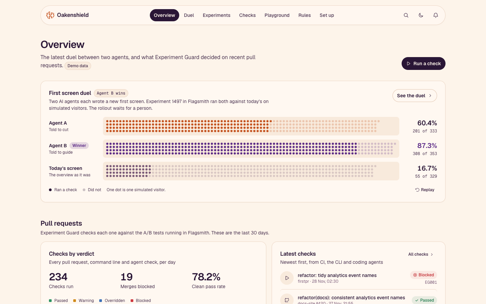
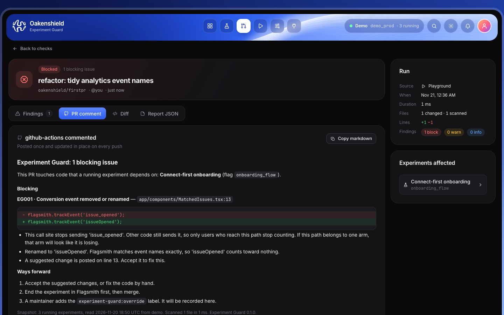
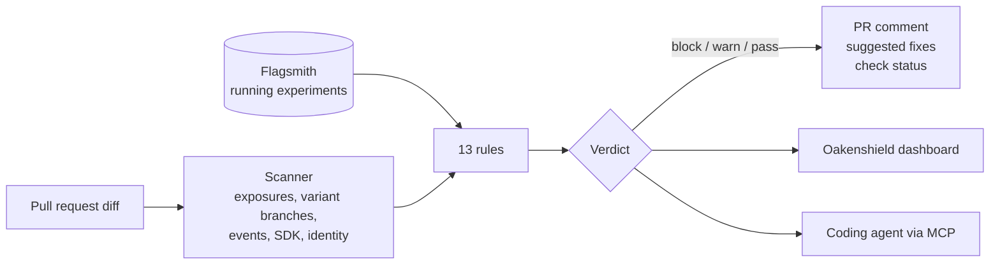
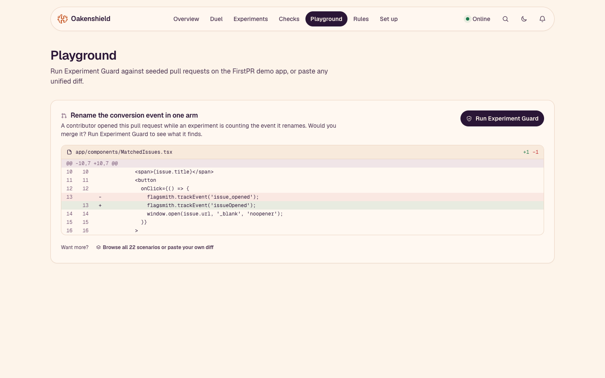

<p align="center"></p>

# Oakenshield · Experiment Guard

**Stops pull requests from silently corrupting running Flagsmith experiments.**

A teammate renames `issue_opened` to `issueOpened` in a tidy-up PR. Tests pass, review passes, it ships. Flagsmith matches event names exactly, so from that moment one arm of your running experiment stops counting conversions. Two weeks later the experiment "wins" or "loses" for a reason nobody can see.

Experiment Guard reads the experiments that are running in Flagsmith right now, diffs the pull request, and blocks the merge when the change provably breaks what an experiment measures or serves. It explains the consequence in plain words, posts a one-click suggested fix, and lets a maintainer override with a label that gets recorded.



| | |
|---|---|
|  |  |

## Where you use it

Experiment Guard runs where code changes, not in a separate tool you have to remember to open:

| Where | How | What happens |
|---|---|---|
| **Pull requests** | GitHub Action (`action.yml`) | One comment per PR with the consequence and a suggested fix; the check fails on a blocking finding; a maintainer can override with a label. |
| **Coding agents** | MCP server (`experiment-guard mcp`) | Claude Code, Cursor and other MCP clients call `check_experiment_impact` on their own edits before they finish. |
| **Terminal and other CI** | CLI (`experiment-guard check`) | Check a branch or uncommitted work before pushing; exit code 1 on a block. |
| **Dashboard** | `apps/server` + `apps/dashboard` | Results from every repository, experiment code maps, rule settings, and a playground. The dashboard's *Set up* page has copy-paste snippets for all of the above. |

Nothing is published to npm or the GitHub Marketplace yet. To use it today, reference the Action as `kartikangiras/oakenshield@main` from a workflow, and run the CLI and MCP server from a clone (`cd packages/guard && npm link` puts `experiment-guard` on your PATH).

## What is in this repository

| Part | Path | What it does |
|---|---|---|
| Engine + CLI | `packages/guard` | Diff parsing, scanner, 13 rules, report rendering, Flagsmith client (experiments, metrics, segments). Zero runtime dependencies. |
| GitHub Action | `action.yml` | Comments on the PR, posts suggested changes, fails the check, honours an override label. Flagsmith auth over OIDC, no stored key. |
| MCP server | `experiment-guard mcp` | Lets coding agents (Claude Code, Cursor, …) ask "will this edit break an experiment?" before they make it. |
| API server | `apps/server` | Collects reports from every repo, live event stream, playground, rule settings. |
| Dashboard | `apps/dashboard` | React 19 dashboard: overview, experiments and their code, checks, playground, rules, integrations. |
| Demo app | `examples/demo-app` | FirstPR, a small Next.js app with a running "Connect-first onboarding" experiment, plus 22 seeded pull requests. |

## Quick start

Requires Node 22.18 or newer (TypeScript runs natively, no build step for the engine or server).

```bash
npm install
npm run dev          # API on :8787 + landing page on http://localhost:5173, dashboard on /app/
```

Or build once and serve everything from one port:

```bash
npm run demo         # landing page on http://127.0.0.1:8787, dashboard on /app/
```

With no Flagsmith settings the server runs on demo data: five experiments (three running) and 60 days of real Experiment Guard runs against the demo app. A new demo check arrives every 45 seconds so the live views move; set `OAKENSHIELD_DEMO_TICK=0` to stop that.

Try the engine on its own:

```bash
npm run guard -- demo rename-event          # run one seeded scenario
npm run guard -- rules                      # list the rules
npm run guard -- check --demo --base HEAD~1 # check your last commit against the demo snapshot
```

## How a check works



1. **Read Flagsmith.** For each running experiment: the flag, its variation keys, the metric events, the environment, and the segments that decide its audience (with the traits their rules match on). Through the Admin API with an API key, or the Flagsmith CLI authenticated by GitHub OIDC.
2. **Diff.** `git diff base...head`, plus the head version of every touched file. Works on uncommitted changes (`--head WORKTREE`) and on pasted diffs.
3. **Scan.** Find exposure calls (`useExperiment`, `getExperimentFlag`, …), branches on variation keys, `trackEvent` calls, SDK versions, `enableEvents`, identity code. Your own functions that wrap the SDK are read the same way once you list them under `calls`.
4. **Rules.** Thirteen rules. Only deterministic ones block by default, so a red check always means the code provably disagrees with Flagsmith.
5. **Report.** One PR comment, updated in place. Inline suggested changes where the fix is mechanical. A maintainer can add `experiment-guard:override`; the override and who added it are recorded.

| Rule | Catches | Default |
|---|---|---|
| EG001 | A metric event renamed or removed at a call site | block |
| EG002 | The experiment exposure call removed | block |
| EG003 | `enableEvents` switched off | block |
| EG004 | SDK pinned below the version that can send experiment events | block |
| EG005 | Code checks a variation key Flagsmith does not serve | block |
| EG006 | Code that only one arm renders changed mid-run | warn |
| EG007 | Identity logic changed (users get a new bucket) | warn |
| EG008 | The exposure call moved (who counts as exposed changed) | warn |
| EG009 | An event name that almost matches a metric | info |
| EG010 | A short-lived script that never flushes events | info |
| EG011 | Dynamic event or flag keys the guard cannot check | info |
| EG012 | A trait the experiment's audience segment matches on is no longer sent | block |
| EG013 | The value sent for an audience trait changes | warn |

## How it uses Flagsmith

Flagsmith is the source of truth for every check. Nothing about an experiment is written in this repository's config: the guard asks Flagsmith what is running and compares the code against the answer.

| Flagsmith feature | Where | What it is used for |
|---|---|---|
| Experimentation, through the Admin API | `packages/guard/src/flagsmith.ts` | `environments/{key}/experiments/` lists the running experiments with their metrics and each metric's expected direction, so a guardrail is reported as a guardrail. `projects/{id}/features/{id}/` gives the variation keys. `projects/{id}/segments/{id}/` gives the traits the audience matches on. |
| Flagsmith CLI with GitHub OIDC | `action.yml` | The same requests go through `flagsmith api`, so a workflow needs no stored API key. |
| Webhooks | `apps/server` | A change to a running experiment's flag or audience segment raises an alert. An experiment that starts, ends or changes re-checks the open pull requests against the new state. |
| JavaScript SDK and experiment events | `apps/dashboard`, `examples/demo-app` | The dashboard runs its own A/B test (`demo_start`), and the demo app runs the experiment the seeded pull requests break. |

## GitHub Action

```yaml
# .github/workflows/experiment-guard.yml
name: Experiment Guard
on:
  pull_request:
    types: [opened, synchronize, reopened, labeled, unlabeled]

permissions:
  contents: read
  pull-requests: write
  id-token: write        # Flagsmith OIDC: no API key stored in GitHub

jobs:
  guard:
    runs-on: ubuntu-latest
    steps:
      - uses: actions/checkout@v5
        with:
          fetch-depth: 0
      - uses: kartikangiras/oakenshield@main
        with:
          flagsmith-environment: ${{ vars.FLAGSMITH_ENVIRONMENT }}
          # Without OIDC, store an organisation API key as a secret and pass it instead:
          # auth: api-key
          # flagsmith-api-key: ${{ secrets.FLAGSMITH_API_KEY }}
```

**Make the check required.** A failed check only stops a merge when the branch requires it. Under **Settings → Rules → Rulesets**, add a ruleset for your default branch, turn on **Require status checks to pass**, and add the check `guard` (the job name above). Until you do, a blocking comment says that GitHub will still allow the merge.

Inputs: `flagsmith-environment`, `flagsmith-project`, `flagsmith-api-url` (self-hosted), `auth` (`oidc` or `api-key`), `flagsmith-api-key`, `config`, `working-directory`, `fail-on` (`block`, `warn`, `never`), `report-url` and `report-token` (send results to a dashboard), `demo`.

For OIDC, create a trust relationship in Flagsmith for your repository first. If Flagsmith cannot be reached the guard fails open by default: it warns in the comment and does not block (`flagsmith.fail_open`).

## Configuration

`.experiment-guard.yml` at the repository root. Everything is optional.

```yaml
version: 1
flagsmith:
  environment: prod_env_key   # where your experiments run
  auth: oidc                  # oidc | api_key | cli | none
  fail_open: true
scan:
  include: ["app/**", "src/**", "package.json"]
  exclude: ["**/*.test.*"]
identity_patterns:
  - fp_vid                    # storage keys or cookies behind your identity
calls:                        # your own functions that wrap the SDK
  exposure: [useVariant]      # read like getExperimentFlag and useExperiment
  conversion: [track]         # read like trackEvent
rules:
  EG006: warn                 # block | warn | info | off
override:
  label: experiment-guard:override
  min_permission: maintain
```

Guard recognises the SDK's own calls. If your code reaches the SDK through a wrapper with another name, list it under `calls`. When a running experiment's flag or event appears in your code but not inside a call Guard can read, the report carries a note that says so and points here.

Silence a single line, with a reason that ends up in the report:

```ts
// experiment-guard-ignore EG006: copy fix approved by the experiment owner
```

## Flagsmith webhooks

Code is only half of it: someone can also change a running experiment in Flagsmith. Point Flagsmith's webhooks at the server and Experiment Guard watches that side too.

1. In Flagsmith, add `https://<your-server>/api/webhooks/flagsmith` under **Organisation settings → Webhooks**. Organisation webhooks receive every flag change (`FLAG_UPDATED`, `FLAG_DELETED`) and the audit log (`AUDIT_LOG_CREATED`, including segment edits). An environment webhook works too but only sends flag changes; if you add both, duplicate deliveries are ignored.
2. Give the webhook a secret and start the server with the same value in `OAKENSHIELD_WEBHOOK_SECRET`. Deliveries are verified against `X-Flagsmith-Signature` (hex HMAC-SHA256 of the body).
3. Optionally set `GITHUB_TOKEN` so re-checks write back to pull requests.

What happens on each delivery:

- **A running experiment's flag changes** (weights, value, on/off, segment override) or **is deleted**: an alert in the dashboard bell, as a toast, and on the experiment.
- **A segment that decides an experiment's audience is edited**: an alert.
- **An experiment starts, ends, or changes its metrics, variations or audience**: every open pull request (the latest CI result per PR from the last 14 days) is re-checked against the new snapshot. PRs whose verdict changes get a new check, an updated PR comment, and a commit status named `Experiment Guard (Flagsmith)`. Mark that status as required if you want it to block merges.

On demo data, *Set up → Flagsmith webhooks* has buttons that simulate each case. "Start Sticky docs sign-up CTA" flips two open docs pull requests to blocked.

## Our own A/B test

Oakenshield runs a real experiment on itself with Flagsmith Experimentation: does the demo get more first-time visitors to run a check when it opens on a broken pull request (`try_it`) instead of the overview? The flag is `demo_start`; the metrics are `check_run` and, as a guardrail, `setup_snippet_copied`. It is off unless the server is started with `DASHBOARD_FLAGSMITH_ENVIRONMENT`.

| Control: the overview | `try_it`: one broken pull request, one button |
|---|---|
|  |  |

Experiment Guard guards that experiment in this repository's own pull requests: rename an event, the flag or the variation, turn events off or pin an old SDK, and the PR is blocked.

## MCP for coding agents

```bash
claude mcp add experiment-guard -- node /path/to/oakenshield/packages/guard/bin/experiment-guard.js mcp
```

Tools: `list_protected_experiments`, `check_experiment_impact` (checks uncommitted changes by default, or any refs or unified diff, and returns findings), `explain_rule`. Pass `--demo` to try it without Flagsmith; set `FLAGSMITH_API_KEY` and `GUARD_FLAGSMITH_ENVIRONMENT` for real data.

## Dashboard and API

The server keeps a JSON store (`apps/server/.data/`), streams events over SSE, and serves the built dashboard.

| Env | Default | |
|---|---|---|
| `PORT`, `HOST` | `8787`, `127.0.0.1` | |
| `OAKENSHIELD_MODE` | auto | `demo` or `live`. Live when Flagsmith settings are present. |
| `FLAGSMITH_API_KEY`, `GUARD_FLAGSMITH_ENVIRONMENT` | | Live Flagsmith data |
| `OAKENSHIELD_REPO_PATH` | | A checkout to scan for code references |
| `OAKENSHIELD_TOKEN` | | Bearer token required on `POST /api/reports` |
| `OAKENSHIELD_WEBHOOK_SECRET` | | Secret set on the Flagsmith webhooks; unsigned deliveries are rejected when set |
| `GITHUB_TOKEN`, `GITHUB_API_URL` | | Lets webhook re-checks update PR comments and commit statuses |
| `OAKENSHIELD_DEMO_TICK` | `45` | Seconds between replayed demo checks, `0` to stop |
| `OAKENSHIELD_RESEED` | | `1` regenerates demo data on start |

Send any CLI or CI run to it with `--report-url https://your-dashboard` (and `OAKENSHIELD_TOKEN`).

Endpoints: `POST /api/webhooks/flagsmith`, `GET /api/alerts`, `POST /api/flagsmith/simulate` (demo), `GET /api/health`, `GET /api/client-config`, `/api/overview?days=30`, `/api/experiments[/:id]`, `/api/checks?verdict=&repo=&rule=&q=`, `/api/checks/:id`, `POST /api/checks` (`{scenarioId}` or `{diff}`), `POST /api/reports`, `GET|PUT /api/rules[/:id]`, `GET|PUT /api/settings`, `GET /api/scenarios`, `GET /api/stream`.

## Development

```bash
npm test             # engine scenarios, parsers, git integration, MCP, API
npm run e2e          # every surface end to end: CLI, Action, MCP, live server, signed webhooks, the Flagsmith SDK
npm run typecheck
npm run build        # dashboard -> apps/dashboard/dist
```

The engine and server are plain TypeScript run directly by Node (erasable syntax only: no enums, no parameter properties, `.ts` import extensions). The scenario suite in `examples/scenarios.json` is the spec: every seeded pull request must get exactly its expected verdict and rules, and the eight "should pass" ones must stay quiet.

```
packages/guard/src
  engine.ts        runCheck(): diff -> findings -> verdict
  scanner.ts       what a line does: exposure, variant, event, SDK, identity
  rules/           EG001–EG013
  traits.ts        where code sends Flagsmith traits
  flagsmith.ts     Admin API and CLI clients, snapshot files
  github.ts        PR comment, suggestions, override label, step summary
  mcp.ts           stdio MCP server
apps/server/src    node:http API, store, stats, demo seed, SSE
apps/dashboard/src React dashboard, hand-written CSS and SVG charts
```

## Roadmap

- New findings after an override need a fresh override (today the label covers later pushes too).
- A rule for a conversion call that moves: EG008 covers the exposure call, but moving `trackEvent` also changes what counts.
- Go, Java and Flutter call-site scanners (the SDK version rule already covers them; the scanner reads JS/TS and Python).
- Pull the metric definitions straight from Flagsmith experiment results as the API grows.
- GitLab merge request comments.

## License

MIT
